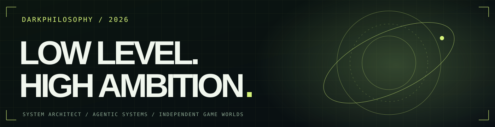

<div align="center">
  <a href="https://github.com/DarkPhilosophy">
    
  </a>
  <br />
  <br />
  <b>SYSTEM ARCHITECT &nbsp;·&nbsp; OPEN-SOURCE DEVELOPER &nbsp;·&nbsp; GAME CREATOR</b>
  <br />
  <sub>I engineer what runs beneath the surface — and imagine what lives beyond it.</sub>
  <br />
  <br />
  <a href="https://darkphilosophy.github.io/DarkPhilosophy/">Interactive Portfolio</a> &nbsp;·&nbsp;
  <a href="https://axxa.dev">AXXA.DEV</a> &nbsp;·&nbsp;
  <a href="https://github.com/DarkPhilosophy?tab=repositories">All Repositories</a>
</div>

---

### `> about --short`

I'm **Alex / DarkPhilosophy**. I design and build software across **Linux internals, agentic AI systems, developer tooling, performance engineering, and desktop experiences**. I also develop original games, where the problems are different but the architectural mindset stays the same.

I like software that is fast, comprehensible, maintainable, and worth using.

### `> projects --in-development`

| Project | Focus | Status |
| :--- | :--- | :--- |
| **Attyx** | Terminal engine + graphical workspace | `IN DEVELOPMENT` |
| **Heresia** | Experimental software project | `IN DEVELOPMENT` |
| **Peersus** | Secure peer-to-peer file sharing concept with planned E2E encryption, device pairing and clipboard sync | `IN DEVELOPMENT` |
| **Timehacker** | Cyberpunk 2D/3D JRPG adventure built around time manipulation | `IN DEVELOPMENT` |
| **Project Pandorium** | Original game; further details not yet public | `IN DEVELOPMENT` |

### `> worlds --preview`

<table>
  <tr>
    <td width="50%" align="center"><br /><b>TIMEHACKER</b><br /><sub>Cyberpunk · 2D/3D · JRPG · Time manipulation</sub></td>
    <td width="50%" align="center"><br /><b>PROJECT PANDORIUM</b><br /><sub>Original game · In development · Details to be revealed</sub></td>
  </tr>
</table>

<sub>Concept art created for this profile; not actual in-game screenshots.</sub>

### `> projects --open-source`

| Repository | What it explores |
| :--- | :--- |
| [`omp-headroom`](https://github.com/DarkPhilosophy/omp-headroom) | Context compression and integration for the Oh My Pi agent ecosystem. |
| [`mcp-system-monitor`](https://github.com/DarkPhilosophy/mcp-system-monitor) | Linux system observability accessible to AI agents via MCP and HTTP. |
| [`mcp-system-monitor-js`](https://github.com/DarkPhilosophy/mcp-system-monitor-js) | JavaScript implementation of MCP system telemetry. |
| [`batt-watt-power-monitor`](https://github.com/DarkPhilosophy/batt-watt-power-monitor) | Power telemetry and battery insight in GNOME Shell. |
| [`zsh-bench`](https://github.com/DarkPhilosophy/zsh-bench) | Measuring and profiling ZSH startup performance. |
| [`v`](https://github.com/DarkPhilosophy/v) | Custom Vencord plugins and managed setup experience. |
| `Snapify` *(private repository)* | Android screenshot management automation. |

### `> philosophy`

**Observe deeply. Engineer deliberately. Iterate relentlessly.**

```text
SYSTEMS      Linux · Rust · TypeScript · Performance
AGENTS       MCP · Observability · Tooling · Orchestration
INTERFACES   Desktop · Terminal · Developer Experience
WORLDS       Timehacker · Project Pandorium
EXPERIMENTS  Peersus · Attyx · Heresia
```

### `> independent websites`

My main digital home is **[axxa.dev](https://axxa.dev)**. I also work on side projects, including **[poo.wang](https://poo.wang)** and the **[isy.ro](https://isy.ro)** website. Some experiments remain private until they're ready to be shown.

### `> connect`

Interested in **systems architecture, performance optimization, developer tools, AI agents, open source, or game development**? Find me through [GitHub](https://github.com/DarkPhilosophy) or [axxa.dev](https://axxa.dev).

<div align="center"><sub>ENGINEER SYSTEMS. IMAGINE WORLDS. — DARKPHILOSOPHY</sub></div>